

  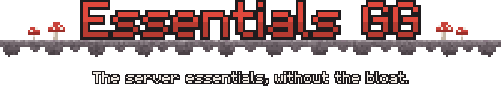

  
  
  
  
  
  
  
  

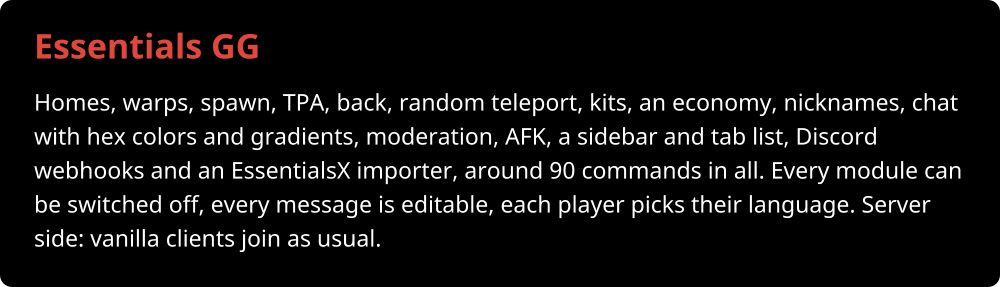

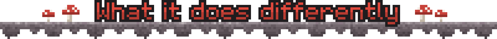

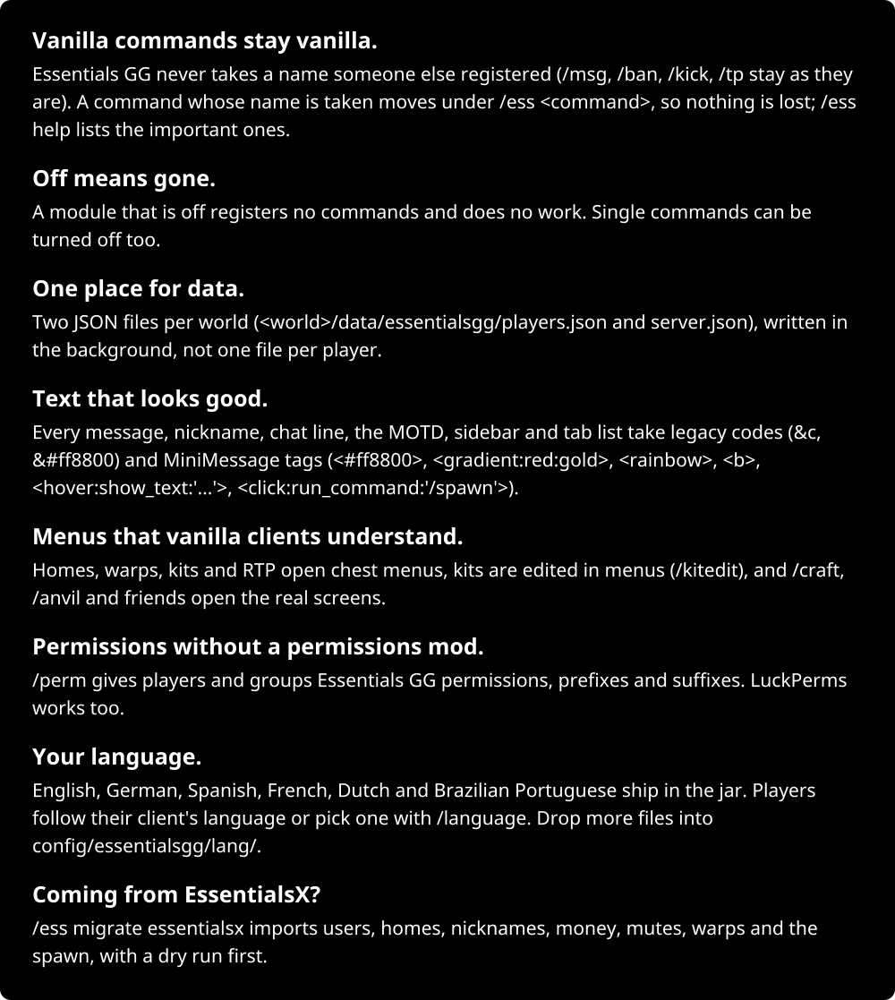, so nothing is lost; /ess help lists the important ones. Off means gone.: A module that is off registers no commands and does no work. Single commands can be turned off too. One place for data.: Two JSON files p" width="100%">

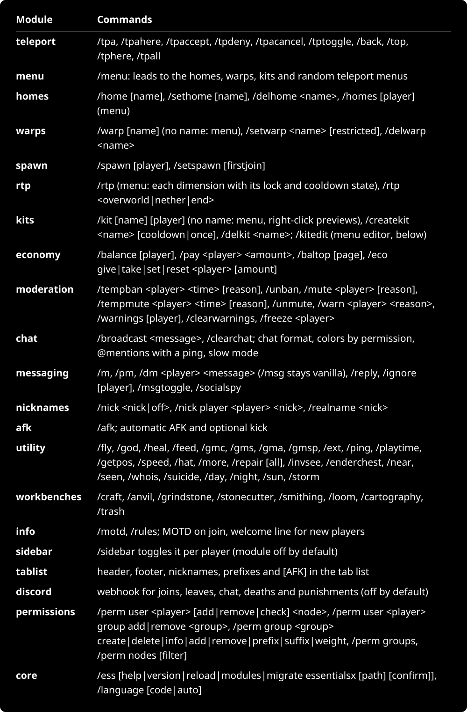, /homes [player] (menu); warps, /warp [name] (no name: menu), /setwarp <name> [restricted], /delwarp <name>; spawn, /spawn [player], /setspawn [firstjoin]; rtp, /rtp (menu: ea" width="100%">

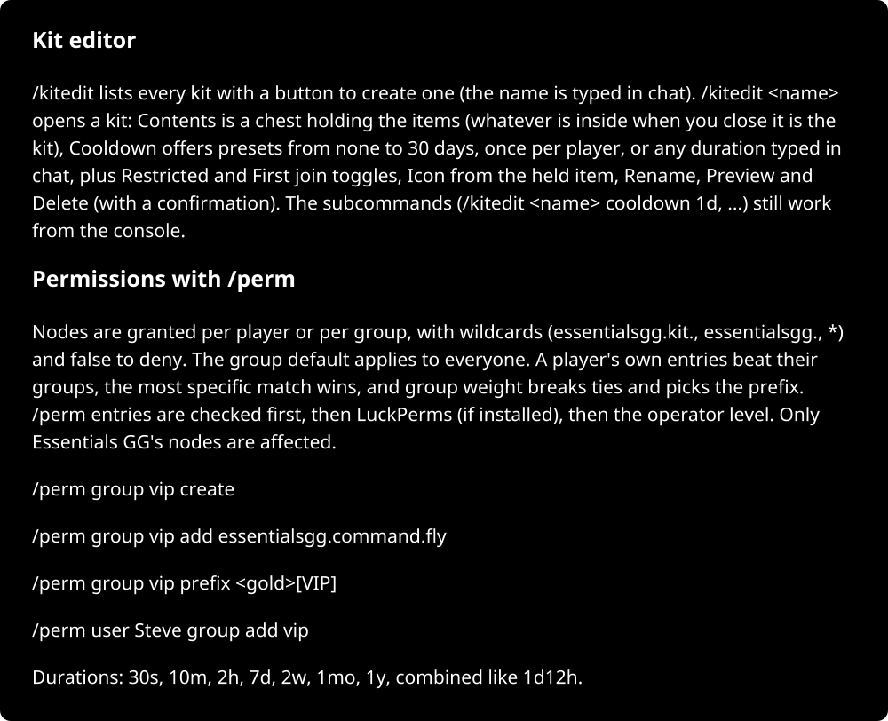 opens a kit: Contents is a chest holding the items (whatever is inside when you close it is the kit), Cooldown offers presets from none to 30 days, once per player, or any duration typed in chat, plus Restricted and First join toggles, Icon from the held item, Rename, Preview and Delete (" width="100%">

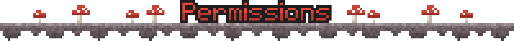

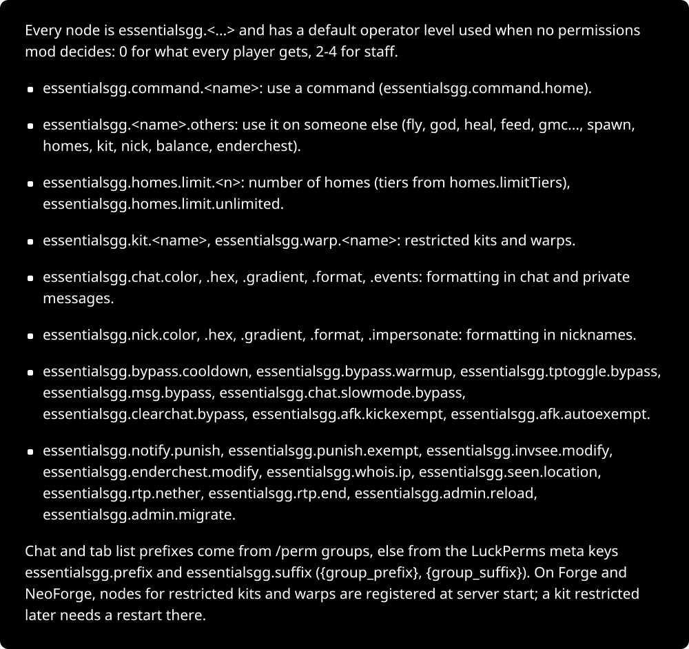 and has a default operator level used when no permissions mod decides: 0 for what every player gets, 2-4 for staff. essentialsgg.command.<name>: use a command (essentialsgg.command.home). essentialsgg.<name>.others: use it on someone else (fly, god, heal, feed, gmc..., spawn, homes, kit, nick, balance, enderchest). essentialsgg.homes.limit.<n>: number of homes (tie" width="100%">

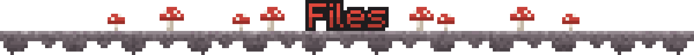

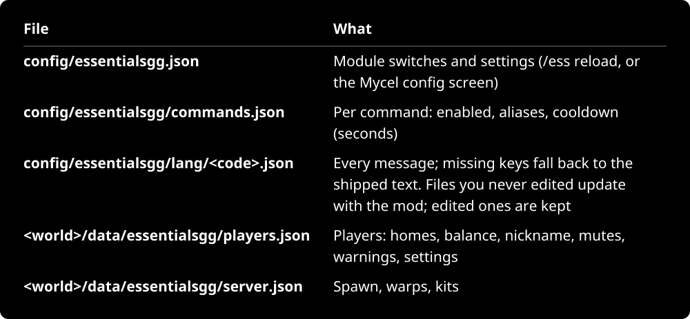.json, Every message; missing keys fall back to the shipped text. Files you never edited update with the mod; edited ones are kept; <world>/data/essentialsgg/players.json, Players: home" width="100%">

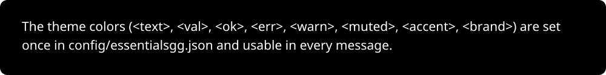, <val>, <ok>, <err>, <warn>, <muted>, <accent>, <brand>) are set once in config/essentialsgg.json and usable in every message." width="100%">

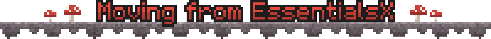

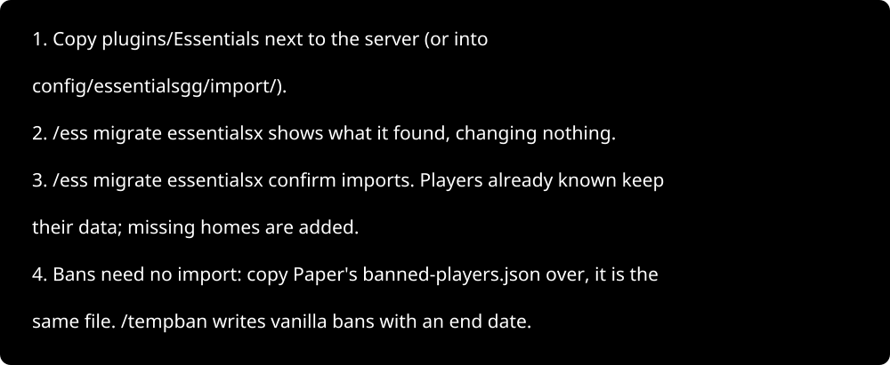

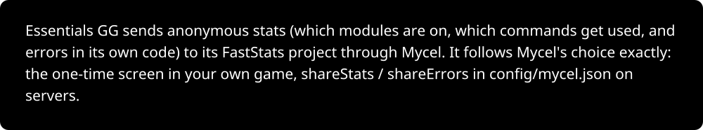
